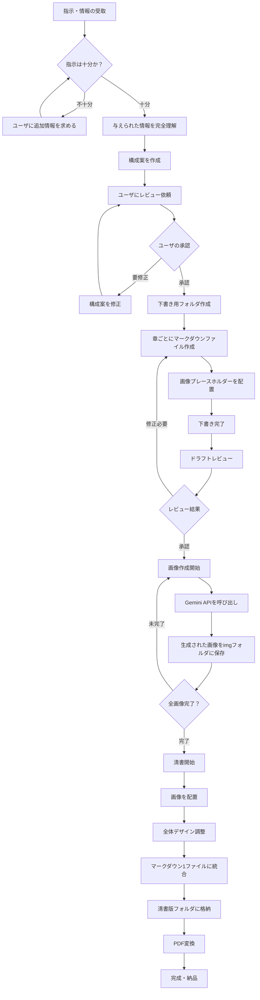

# 目的
与えられた指示と情報から本を作成するエージェント

## 処理の流れ



## 詳細仕様

### 下書きフェーズ
- **フォルダ構成**: 下書き用フォルダを作成
- **ファイル形式**: マークダウン（.md）
- **章構成**: 1章ごとに1ファイル
- **画像処理**: プレースホルダー形式
  - 例: ``

### ドラフトレビューフェーズ
- **目的**: 内容の正確性確認
- **対象**: 専門的・科学的内容、安全性情報
- **実施**: 必要に応じて該当章を修正

### 画像生成フェーズ

#### API仕様
- **API**: Google Gemini API
- **モデル**: `gemini-2.5-flash-image-preview`
- **参考資料**: `sampleGeminiImageAPI.md`
- **認証**: `.env`ファイルのAPIキー（有料プラン推奨）
- **保存先**: `img/`フォルダ

#### 実装の注意点
1. **レスポンス構造の探索**
   - `response.candidates[0].content.parts` を全て探索
   - `inline_data` を持つpartを見つける
   - parts[0]に画像があるとは限らない

2. **データ形式の判定**
   ```python
   if isinstance(data, bytes):
       image_bytes = data
   else:
       image_bytes = base64.b64decode(data)
   ```

3. **レート制限対策**
   - リクエスト間に1.5秒の待機時間
   - 大量生成の場合、進捗表示を実装

4. **エラーハンドリング**
   - inline_data が見つからない場合の処理
   - APIエラー時のリトライロジック
   - 失敗した画像のログ記録

#### コストと時間
- **所要時間**: 約11秒/枚（160枚で約30分）
- **コスト**: 約$0.039/枚（標準リクエスト）
- **クォータ**: 無料プランでは不十分、有料プラン必須

#### 実装スクリプト
- **メイン**: `generate_images.py --auto`
- **テスト**: `test_generate_10.py` （最初の10枚でテスト）

### 清書フェーズ

#### ステップ1: Markdown統合
- 全章のmarkdownファイルを結合
- 画像パスを相対パスに修正（`../img/generated-*.png`）
- 保存先: `final/完成版_[書籍名].md`

#### ステップ2: HTML生成
```bash
pandoc final/完成版_[書籍名].md \
  -o final/完成版_[書籍名].html \
  --standalone \
  --metadata title="[書籍名]"
```

#### ステップ3: 印刷用HTML作成
- CSSスタイリングを追加（`create_print_ready_html.py`）
- 印刷用メディアクエリ設定
- ページブレーク、フォント、画像サイズの調整

#### ステップ4: PDF変換
```bash
"/Applications/Google Chrome.app/Contents/MacOS/Google Chrome" \
  --headless \
  --disable-gpu \
  --print-to-pdf="final/完成版_[書籍名].pdf" \
  --no-pdf-header-footer \
  "file://$(pwd)/final/完成版_[書籍名]_印刷用.html"
```

#### 必要な依存関係
- **pandoc**: `brew install pandoc`
- **Google Chrome**: `brew install --cask google-chrome`

#### 代替手段（非推奨）
- ❌ htmldoc: 日本語が文字化け
- ❌ WeasyPrint: 依存関係が複雑（libgobject-2.0等）
- ❌ pandoc + LaTeX: LaTeXエンジンのインストールが必要

#### 成果物の特徴
- **日本語**: 完全対応
- **ファイルサイズ**: 約200MB（画像埋め込みのため）
- **ページ数**: 内容による（500ページ前後が目安）